<div align="center">

# NEON//FLOW

**Console cyberpunk ao vivo para o fluxo de agentes de IA no [Maestri](https://maestri.app).**
Mapa de quem está trabalhando, ligações energizadas, ferramentas em uso, avisos quando um agente precisa de você e o terminal completo de cada agente, com envio de comandos.


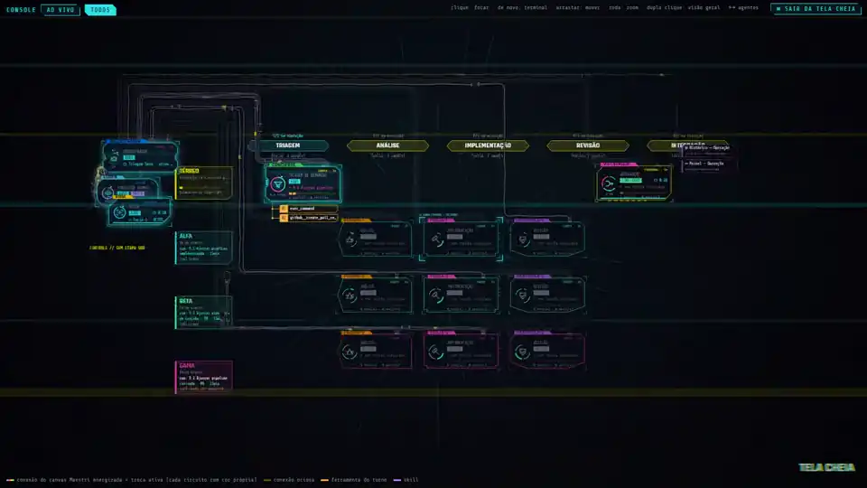

<sub>Simulação embutida (<code>?demo=1</code>) gravada em tela cheia · <a href="docs/media/visao-geral.mp4">vídeo em MP4</a></sub>

</div>

---

## Sumário

- [Em ação](#em-ação)
- [O que você vê](#o-que-você-vê)
- [Começar em 30 segundos](#começar-em-30-segundos)
- [Ao vivo com o Maestri](#ao-vivo-com-o-maestri)
- [Como funciona](#como-funciona)
- [Segurança](#segurança)
- [Adaptar a outro projeto](#adaptar-a-outro-projeto)
- [Estrutura e testes](#estrutura-e-testes)
- [Licença](#licença)

## Em ação

Um agente para e pergunta. O cartão aparece ao lado do módulo dele; **RESPONDER** abre o terminal completo, você digita a decisão e o agente segue.

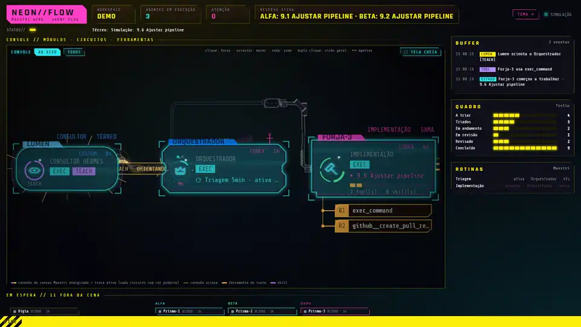

<sub><a href="docs/media/navegacao.mp4">Vídeo em MP4</a> (34 s)</sub>

## O que você vê

### Dois modos de mapa

<table>
<tr>
<td width="50%">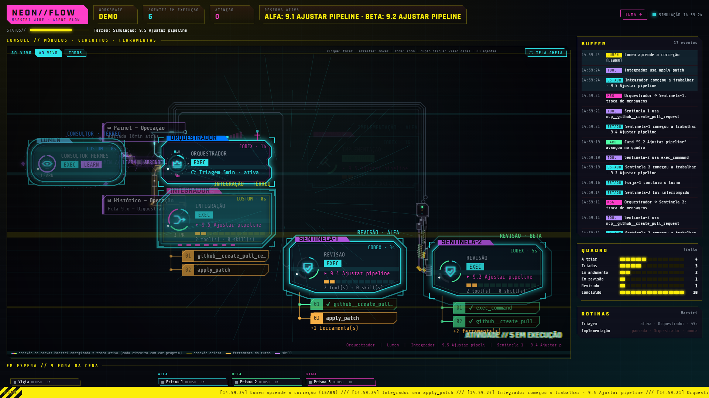</td>
<td width="50%">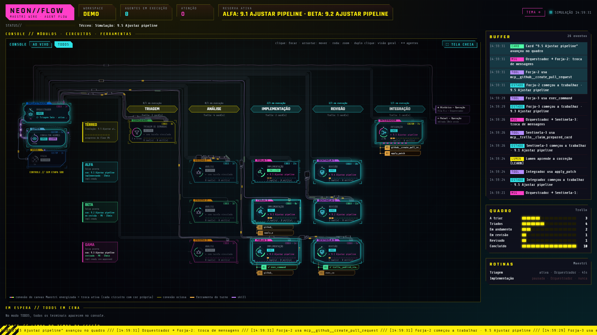</td>
</tr>
<tr>
<td><b>AO VIVO</b>: só quem está executando agora. Orquestrador no centro, Vigia em cima, Integrador embaixo, Lumen à esquerda e Concierge à direita; cada equipe vira uma coluna (Prisma, Forja, Sentinela). Colunas vazias somem e a câmera reenquadra sozinha.</td>
<td><b>TODOS</b>: o canvas inteiro. Colunas por etapa (Triagem → Análise → Implementação → Revisão → Integração), linhas por equipe, coluna de controle à esquerda e notas à direita. Buffer de eventos, quadro do Trello e rotinas nas laterais.</td>
</tr>
</table>

### Quando um agente precisa de você

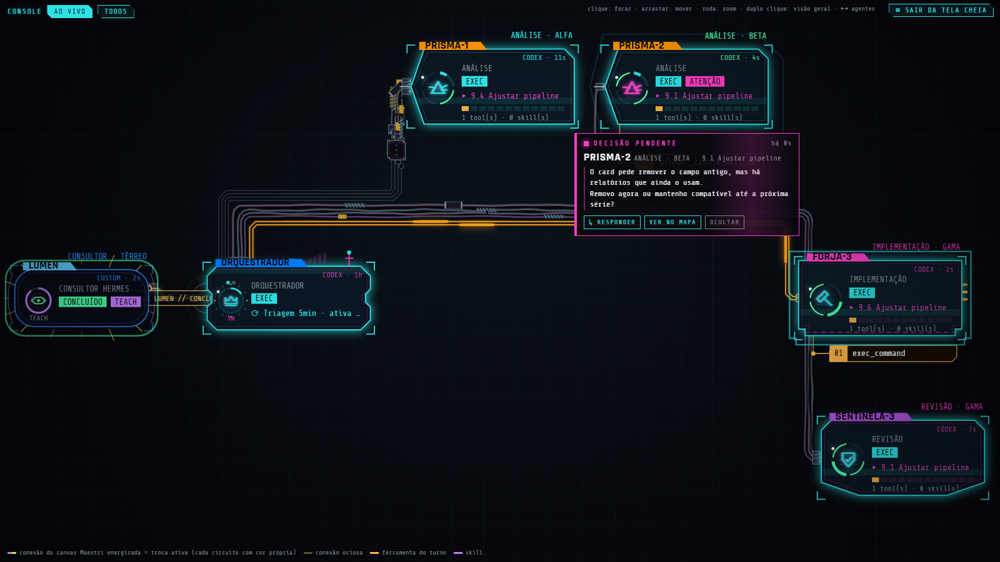

- O cartão **DECISÃO PENDENTE** fica ao lado do módulo do agente, com seta apontando para ele. Ele acompanha a câmera e escolhe o lado que não cobre outros módulos. Falhas aparecem do mesmo jeito, em vermelho.
- A pergunta vem do campo `question` ou, sem ele, das últimas linhas do terminal.
- Fora da página: o título da aba mostra `(1) ⚠ decisão`, toca um bipe curto e, se você permitir, chega uma notificação do sistema. Clicar nela abre o agente.

### Terminal completo, com envio

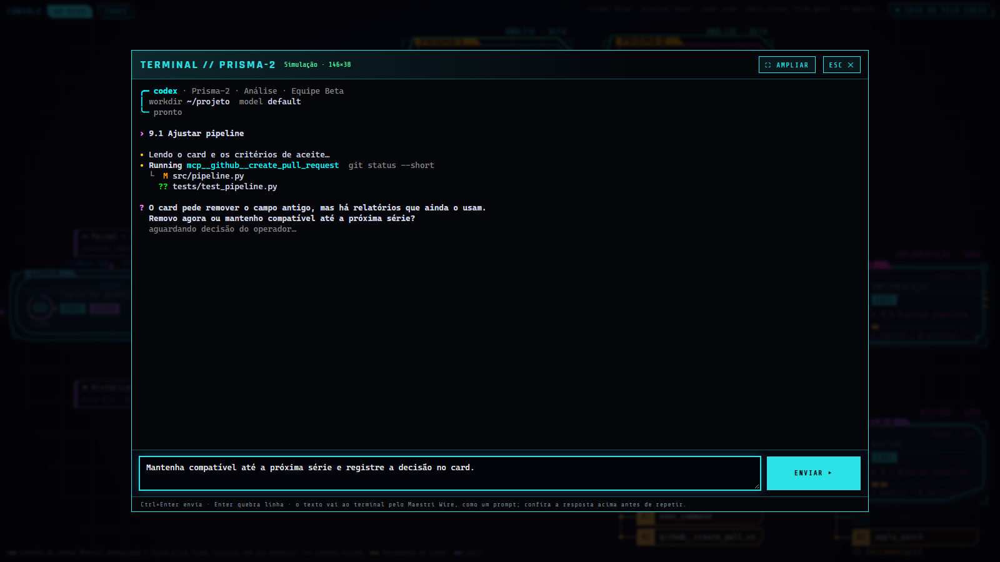

- É o terminal real do agente, transmitido pelo Maestri Wire e desenhado com [xterm.js](https://github.com/xtermjs/xterm.js): cores, cursor e tamanho iguais aos do Maestri.
- O campo de baixo manda o texto como prompt para aquele terminal. **Ctrl+Enter** envia, **Enter** quebra linha. **AMPLIAR** ocupa a janela inteira.
- Cada agente guarda o próprio rascunho enquanto a página estiver aberta.

### Foco, detalhe e tela cheia

<table>
<tr>
<td width="50%">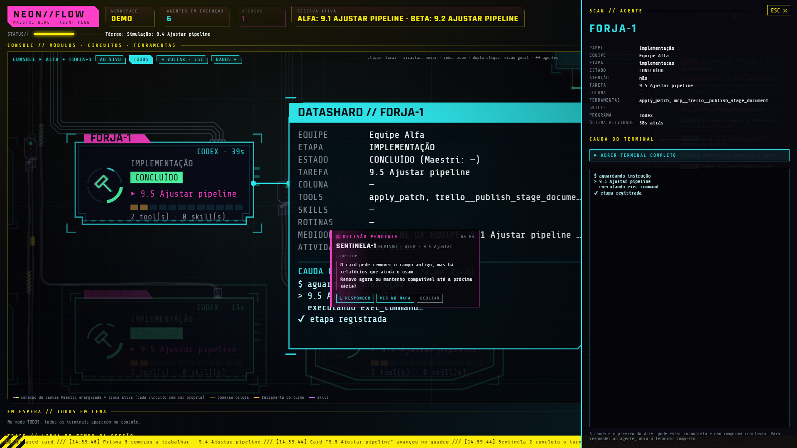</td>
<td width="50%">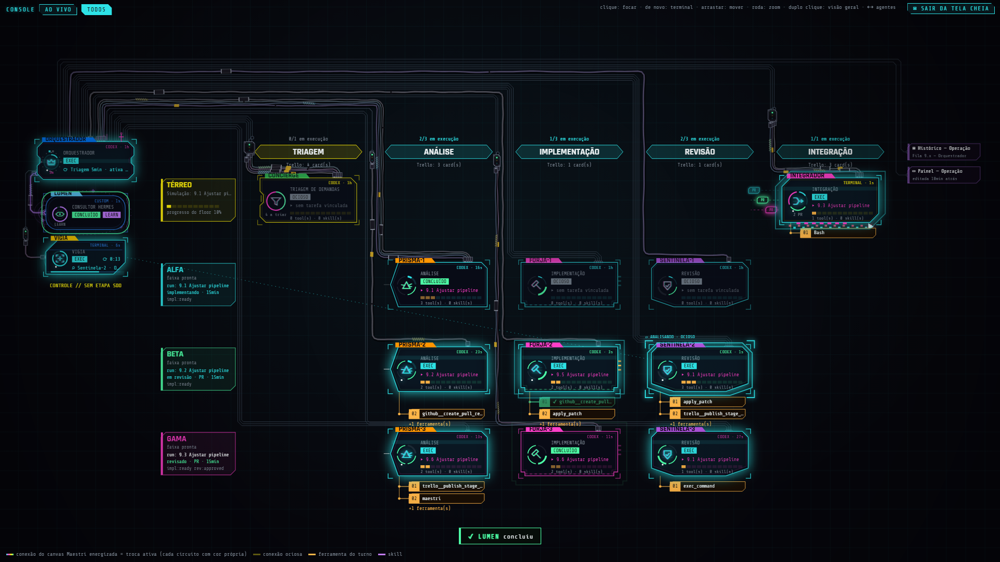</td>
</tr>
<tr>
<td>Clique num módulo: a câmera voa até ele (<code>ACESSANDO // NOME</code>) e a <i>datashard</i> mostra equipe, etapa, tarefa, ferramentas e a cauda do terminal. <b>▶ TERMINAL</b>, um segundo clique no módulo ou a tecla <kbd>T</kbd> abrem o terminal para enviar mensagens; <b>DADOS ▸</b> abre o painel lateral.</td>
<td><b>⛶ TELA CHEIA</b> esconde os painéis e reenquadra o mapa. Arrastar move, roda dá zoom, duplo clique volta à visão geral e <kbd>Esc</kbd> sai.</td>
</tr>
</table>

### Três estilos de ligação

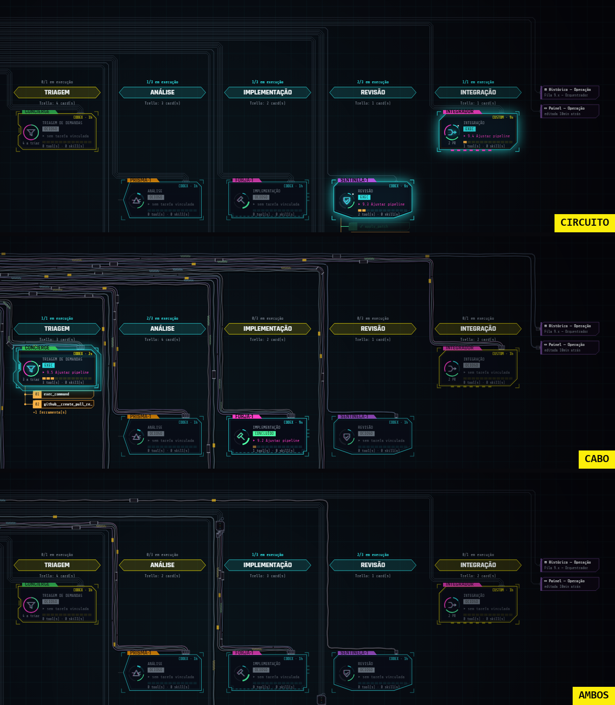

**CIRCUITO** (trilhas de placa a 90° e 45°, com *pads*), **CABO** (cabos gastos com fita, emendas, abraçadeiras e plugues) ou **AMBOS** (circuitos, cabos e trechos que entram numa caixa de junção e viram cabo). Nos três, as rotas contornam os módulos e não se cruzam. Ligação ativa acende com a cor do agente e pulsos correndo.

### Seis temas

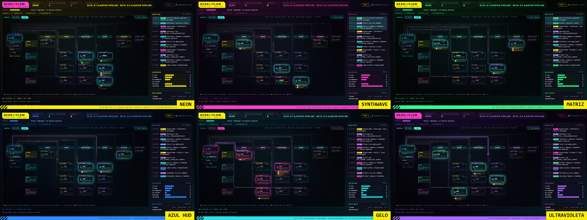

Menu **TEMA**: Neon, Synthwave, Matriz, Azul HUD, Gelo e Ultravioleta. Vermelho fica reservado para falhas em todos eles. Tema e estilo de ligação ficam salvos no navegador.

## Começar em 30 segundos

Requer **Python 3.11+**.

```bash
git clone https://github.com/alan-almeida81/neon-flow.git
cd neon-flow
pip install -e .
python -m neon_flow serve
```

Abra **http://127.0.0.1:8770/?demo=1**. A simulação gera agentes, ferramentas, pedidos de decisão e um terminal de exemplo que responde ao que você enviar; nada sai do navegador.

Sem instalar nada, também dá para abrir direto o arquivo `web/index.html?demo=1`.

## Ao vivo com o Maestri

1. No Maestri: **Settings → Wire → Pairing**. Anote o endereço, a chave `serverKeyHash` do QR e o código de 6 dígitos.
2. Pareie esta máquina (uma vez por máquina):

   ```bash
   python -m neon_flow pair --host https://SEU-HOST.local:7434 --key SERVERKEYHASH --code 123456
   ```

   O token fica no keyring do sistema e os metadados (host, porta, chave e id do dispositivo) em `~/.neon-flow/wire.json`.
3. Inicie e abra **http://127.0.0.1:8770/**:

   ```bash
   python -m neon_flow serve
   ```

Para enviar comandos pelo terminal, o pareamento precisa ter permissão de envio no Maestri.

**Fontes opcionais** (para testar sem o Wire ou enriquecer o mapa):

| Opção | Conteúdo |
|---|---|
| `--snapshot feed.json` | feed do Maestri gravado (em vez do Wire ao vivo) |
| `--runtime runtime.json` | estado de runtime dos agentes: `agents[]` com `roleName`, `status`, `activeTools`, `skills`, `cardId`, `mode`… |
| `--board board.json` | quadro de cards: `lists`, `cards`, `history.runs`, `activeRun` |
| `--port 8770` | porta local |

## Como funciona

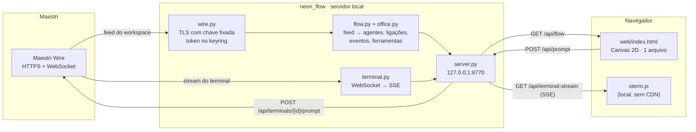

### Endpoints locais

| Método e caminho | O que faz |
|---|---|
| `GET /` | o console (`web/index.html`); `?demo=1` liga a simulação |
| `GET /api/flow` | a projeção do fluxo em JSON ([contrato](docs/CONTRATO-DE-DADOS.md)) |
| `GET /api/terminal-stream?terminalId=<uuid>` | saída e geometria de um terminal, como Server-Sent Events |
| `POST /api/prompt` `{terminalId, text}` | envia o texto digitado àquele terminal (até 20 mil caracteres) |
| `GET /vendor/xterm/xterm.js` e `.css` | o xterm.js empacotado |

### Do feed ao mapa

- **Papéis:** saem do nome e do papel de cada terminal no Maestri ([convenções](#adaptar-a-outro-projeto)). As equipes vêm dos *floors*, por exemplo "Equipe Alfa".
- **Ligações:** as conexões do canvas do Maestri viram feixes roteados em faixas, com trilhas a 90° e 45° que contornam os módulos. A ordem das faixas é fixa; o desenho de cada ligação (posição das dobras, lado das curvas, estilo no modo AMBOS e cores) é sorteado a cada abertura da página, então o visual muda sem perder a leitura.
- **Estados:** ciano = executando, verde = concluído, cinza = ocioso, vermelho = interrompido ou falha. Uma mudança de estado faz o módulo tremer e expandir um contorno.
- **Ferramentas:** as do turno aparecem numeradas sob o módulo, entram digitadas e ficam verdes com ✔ ao terminar.
- **Eventos:** o servidor compara cada feed com o anterior e transforma as diferenças em eventos (estado, atenção, ferramenta, mensagem, nota, rotina, card). Eles alimentam o **BUFFER**, a linha do tempo e o letreiro inferior.
- **Câmera:** em AO VIVO, quando quem está em cena muda, a câmera reenquadra sozinha, a menos que você esteja movendo o mapa.

Detalhes visuais (silhuetas por papel, medidores, animações) em [docs/NEON-FLOW.md](docs/NEON-FLOW.md).

### Terminal completo, passo a passo

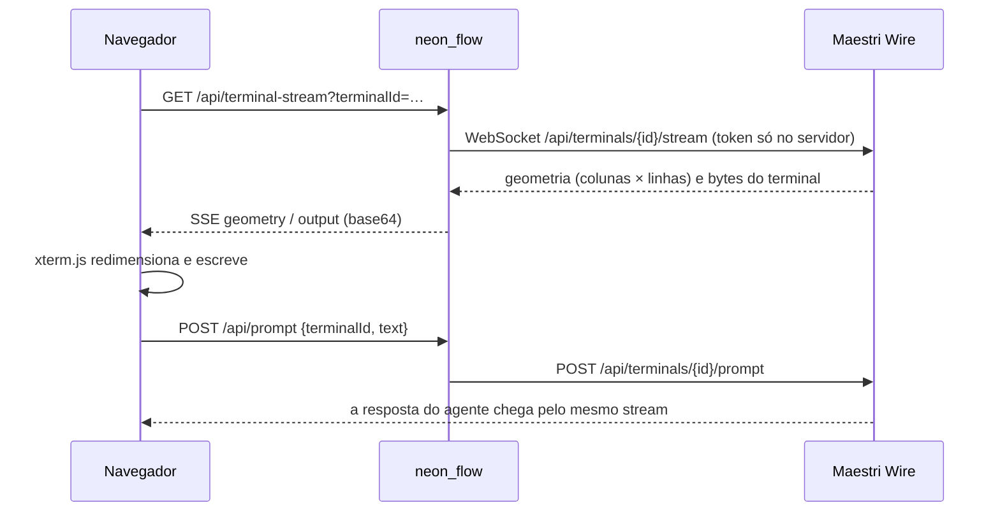

## Segurança

- **O token nunca sai do computador.** Fica no keyring do sistema; o navegador só recebe a saída dos terminais e os dados do mapa.
- **TLS com chave fixada.** A conexão com o Maestri confere o hash da chave do servidor mostrado no QR; certificado trocado é recusado.
- **Só local.** O servidor escuta em `127.0.0.1` e recusa `Host` desconhecido (contra *DNS rebinding*) e `Origin` de outros sites.
- **Envio controlado.** `POST /api/prompt` só aceita JSON vindo do próprio computador, então formulários de outros sites não conseguem disparar comandos. O id do terminal e o tamanho do texto são validados antes de qualquer contato com o Maestri.
- **O resto é leitura.** O mapa não foca terminal nem muda fila, quadro ou rotinas. O único texto enviado a um terminal é o que você digita no campo de envio.

## Adaptar a outro projeto

O papel de cada terminal sai do nome e do papel no Maestri (`neon_flow/flow.py`, listas `STAGES` e `CONTROL`):

| Papel | Nomes reconhecidos |
|---|---|
| Triagem | concierge, triagem |
| Análise | prisma, análise |
| Implementação | forja, implementa |
| Revisão | sentinela, revis |
| Integração | integrador, integra |
| Orquestrador | orquestrador, ou o terminal Maestro |
| Consultor | lumen, hermes, consultor |
| Vigia | vigia |

Para outro vocabulário, ajuste essas listas. Qualquer backend que devolva o JSON do [contrato de dados](docs/CONTRATO-DE-DADOS.md) também alimenta a página, não só o Maestri.

## Estrutura e testes

```text
neon-flow/
├─ neon_flow/
│  ├─ __main__.py     CLI: serve | pair
│  ├─ server.py       servidor local (página, /api/flow, terminal, prompt)
│  ├─ wire.py         cliente Maestri Wire: pareamento, TLS fixado, feed, envio
│  ├─ terminal.py     relay do terminal: WebSocket do Wire → Server-Sent Events
│  ├─ flow.py         feed → contrato de dados do console
│  └─ office.py       eventos, ferramentas e transições entre feeds
├─ web/
│  ├─ index.html      o console inteiro (HTML + CSS + Canvas 2D, sem build)
│  └─ vendor/xterm/   xterm.js 6.0.0 + licença MIT
├─ docs/              contrato de dados, linguagem visual e mídia do README
└─ tests/             testes do fluxo e da segurança do servidor
```

```bash
python -m unittest discover -s tests
```

## Licença

[MIT](LICENSE) © 2026 Alan Almeida. Inclui [xterm.js](https://github.com/xtermjs/xterm.js) (MIT) em `web/vendor/xterm/`.

O Neon Flow é um projeto independente, sem afiliação com o Maestri.
